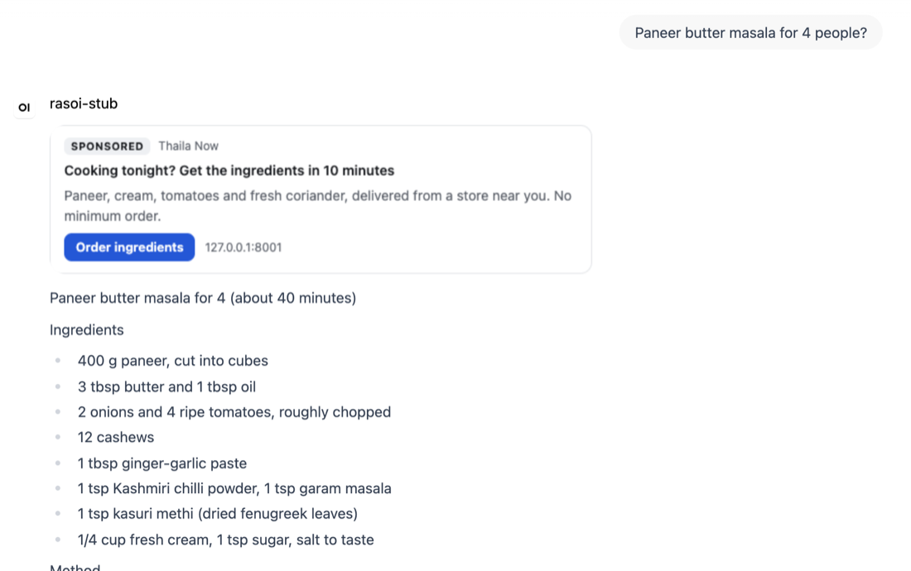

# Aside for Open WebUI

A single-file [Open WebUI](https://github.com/open-webui/open-webui) filter function that shows a card
labeled "Sponsored" with a relevant answer, picked by your own Aside server. The model's answer is never
edited, and a sensitive or unrelated message gets no card at all.



Tested with **Open WebUI 0.12.5** (released 2026-10-29), the current release when this was written.

## Install in 2 minutes

1. **Run Aside** where the Open WebUI server can reach it:

   ```bash
   pip install "aside-ads[embeddings]"
   aside create-key --role publisher --publisher "My Open WebUI"   # prints aside_pub_...
   aside serve                                                      # http://127.0.0.1:8000
   ```

   To try it with sample advertisers instead, run `aside seed-demo --scenario cooking` (the key is in
   `.aside/demo.env`) and start the server with `ASIDE_CURRENCY=INR aside serve`. Campaigns, budgets and
   advertisers are managed in Aside's dashboard at `/dashboard`.

2. **Add the function.** In Open WebUI open **Admin Panel > Functions > Create**, replace the example code
   with the contents of [`aside_sponsored_filter.py`](aside_sponsored_filter.py), check the name and
   description (Open WebUI fills empty ones in from the file) and save.

3. **Set the valves.** Click the gear next to "Aside Sponsored Cards" and fill in:

   | Valve | Set to |
   | --- | --- |
   | `ASIDE_URL` | Your Aside server, e.g. `http://localhost:8000` |
   | `ASIDE_API_KEY` | The `aside_pub_...` key from step 1 |
   | `PLACEMENT` | `default`, or another placement you created in Aside |

4. **Enable it.** Switch the function on. Then either open its `...` menu and choose **Global** (all
   models), or add it to specific models under **Workspace > Models > (model) > Filters**.

Ask something your advertisers match, and the card appears with the answer.

**Open WebUI in Docker, Aside on the host:** set `ASIDE_URL` to `http://host.docker.internal:8000`, start
Aside with `aside serve --host 0.0.0.0`, and set `ASIDE_PUBLIC_URL=http://localhost:8000` (the address your
users' browsers reach Aside at) so the card's links do not point at `host.docker.internal`. On a real
deployment, `ASIDE_PUBLIC_URL` is Aside's public HTTPS address.

## What users see

- After an answer finishes, a card labeled **Sponsored** with the advertiser, a headline, one line of
  text and a button. It sits on the answer, in its own frame, above the answer text, and follows the
  user's light or dark system theme.
- Nothing, when Aside has no ad for the message: nothing relevant enough, a sensitive topic (self-harm,
  medical emergencies, serious illness, minors, abuse, grief, addiction, financial distress, or your own
  terms), a frequency cap, or a spent budget. There is no placeholder or "no ad" notice.
- With `LATEST_TURN_ONLY` on (the default), at most one card per chat: when a new answer arrives, the
  card on the previous answer is removed, whether or not the new answer gets one.
- Clicking the card opens the advertiser in a new tab, through Aside's signed click link.

## Valves

| Valve | Default | What it does |
| --- | --- | --- |
| `ASIDE_URL` | `http://localhost:8000` | Aside server, as the Open WebUI server reaches it |
| `ASIDE_API_KEY` | (empty) | Aside publisher key. Without it the filter does nothing. Masked in the UI |
| `PLACEMENT` | `default` | Aside placement key, so you can price and report Open WebUI separately |
| `ENABLED` | on | Off: the filter does nothing, without uninstalling it |
| `LATEST_TURN_ONLY` | on | Keep a card only with the newest answer |
| `TIMEOUT_SECONDS` | 1.5 | Longest wait for each Aside request. Slow or failing means no card |
| `MIN_TURNS_BETWEEN_CARDS` | 0 | Answers that must pass without a card after one is shown |
| `MAX_CARDS_PER_CHAT` | 0 | Most cards in one chat. 0 means no limit |
| `SEND_USER_ID` | on | Send a one-way hash of the user id for Aside's per-user frequency caps |
| `DEBUG` | off | Log why no card was shown (the reason only) |

Advertiser-side rules, such as relevance thresholds, blocked topics, per-user caps, budgets and pacing, live
in Aside, not here.

## Privacy

- **Only the latest user message is sent**, to your Aside server and nowhere else. No earlier messages,
  no system prompt, no answer, no names or emails, no attachments (only the text of a message with an
  image). Aside uses the text in memory to pick an ad and never stores or logs it.
- **The user id is hashed** (SHA-256, truncated) before it leaves Open WebUI, and Aside hashes it again
  with its own key. Turn `SEND_USER_ID` off to send nothing about the user.
- **The filter stores no chat text.** It keeps small in-memory counters per chat (chat and message ids,
  card counts) for the frequency valves. Logs contain request outcomes, never messages.
- The card that Open WebUI saves with the chat contains only the ad's own text and signed links. It has
  no tracking pixel and no scripts beyond reporting its height to Open WebUI. Links use
  `rel="sponsored noopener noreferrer"`.
- The impression is recorded by the filter, server to server, with the signed impression URL Aside
  returned (`POST /v1/impressions`), once the card has been attached to a finished answer. Aside counts each
  ad at most once, and the filter asks for at most one ad per answer.

## How it works, and why a Rich UI embed

The filter only has an `outlet`, which Open WebUI runs once an answer has finished. It takes the newest
user message from the outlet body, calls `POST /v1/serve`, and, if an ad comes back, emits an
[`embeds` event](https://docs.openwebui.com/features/extensibility/plugin/development/events) through
`__event_emitter__`. Open WebUI stores that HTML in the message's `embeds` field, separate from its
`content`, and renders it in a sandboxed iframe on the answer. The answer text is untouched, and because
the card is not in `content` the model never sees it in later turns. The outlet returns the body unchanged.

Open WebUI offers three ways for a filter to put something on an answer without editing its text. The
[Filter Function docs](https://docs.openwebui.com/features/extensibility/plugin/functions/filter) state that
filters receive `__event_emitter__` and can emit `status`, `embeds` and other persisted events, and the
[events docs](https://docs.openwebui.com/features/extensibility/plugin/development/events) describe each:

- **`source` / `citation`**: rejected. Sources collapse into a "1 Source" button under the answer, so the
  label "Sponsored" is hidden until expanded, and an ad listed among the answer's sources suggests the
  model relied on it.
- **`status`**: rejected. One line of plain text above the answer, with no link or button.
- **`embeds`**: chosen. The only option that shows a complete, clearly labeled card with a working link,
  is saved with the chat, and stays outside the answer text.

Sources for the details above:
[Filter Function](https://docs.openwebui.com/features/extensibility/plugin/functions/filter) (outlet,
`__event_emitter__`, dunder parameters),
[Events](https://docs.openwebui.com/features/extensibility/plugin/development/events) (`embeds`,
`replace`, `source`, `status`, persistence),
[Rich UI Embedding](https://docs.openwebui.com/features/extensibility/plugin/development/rich-ui) (iframe
sandbox, height reporting, rendering position),
[Valves](https://docs.openwebui.com/features/extensibility/plugin/development/valves) (password input).

## Known limits

- **Position.** Open WebUI renders message embeds above the answer text, not in a side column, and scrolls
  a newly added embed into view. The card arrives after the answer has streamed, so the text moves down by
  the card's height.
- **Advertiser tabs are sandboxed.** Open WebUI renders embeds in a sandboxed iframe, and browsers carry
  that sandbox into tabs opened from it. The advertiser's page opens without its own origin, so it cannot
  use cookies or local storage (tested in Chrome with Open WebUI 0.12.5). Simple landing pages work;
  pages that need a login or a cart may not. The click is still counted, because Aside records it on its
  redirect, and the `aside_click_id` parameter still reaches the advertiser. Users who turn on **Settings >
  Interface > iframe Sandbox Allow Same Origin** avoid this, at the cost of a weaker sandbox for every
  embed.
- **No card for direct API calls.** Open WebUI passes no event emitter to `outlet` for `/api/chat/completions`
  callers, so they never trigger a serve. Shared (read-only) chat links do not render embeds either.
- **Counters are per process.** The frequency valves and `LATEST_TURN_ONLY` keep their state in memory:
  it resets when Open WebUI restarts or the function is edited, and each worker or replica counts on its
  own. Aside's per-user frequency caps are shared across all of them.
- **Two Open WebUI internals.** To keep other embeds on a message and to remove an earlier card, the filter
  reads a message's embeds (`Chats.get_message_metadata`) and opens an emitter for an earlier message
  (`open_webui.socket.main.get_event_emitter`). If a release changes these, cards still appear, earlier
  cards stay in place, and new cards are added in merge mode.
- **Temporary chats** show the card but, like the rest of the chat, do not save it.

## Tests

`tests/test_open_webui_filter.py` loads the file the way Open WebUI does and runs it against a mocked Aside
server and against the real Aside app with the cooking demo: a card on a relevant message, nothing on an
irrelevant or sensitive one, no crash on timeouts, connection errors, 4xx and 5xx responses or bad JSON, one
impression per answer, and only the latest user message in the request.

```bash
pip install -e ".[dev]" && pytest tests/test_open_webui_filter.py
```

It was also run in a real Open WebUI 0.12.5 against `aside serve` seeded with `aside seed-demo --scenario
cooking`, which is where the screenshot comes from.

## License

This folder (the filter and this README) is MIT licensed, like the client SDKs, so you can install,
modify and redistribute the filter without AGPL obligations. The Aside server itself is AGPL-3.0.
